# Relaciones de PuntoKampus

Modelo lógico del tramo 1. [SQL completo](puntokampus.sql) · [Reglas y normalización](README.md)

```mermaid
erDiagram
    facultades ||--o{ carreras : contiene
    carreras ||--o{ perfiles_vendedores : estudian
    usuarios ||--o| perfiles_vendedores : tiene
    usuarios ||--o{ sesiones_acceso : inicia
    perfiles_vendedores ||--o| tiendas : posee
    tiendas ||--o{ tiendas_categorias : clasifica
    categorias ||--o{ tiendas_categorias : agrupa
    puntos_entrega ||--o{ tiendas : habitual
    tiendas ||--o{ productos : publica
    productos ||--o{ fotos_productos : ilustra
    usuarios o|--o{ pedidos : compra
    tiendas o|--o{ pedidos : recibe
    puntos_entrega ||--o{ pedidos : entrega
    pedidos ||--o{ detalles_pedidos : incluye
    productos o|--o{ detalles_pedidos : referencia_historica
    tiendas ||--o{ reportes : recibe
    usuarios o|--o{ reportes : reporta_o_revisa
    tiendas o|--o{ solicitudes_premium : solicita
    usuarios o|--o{ solicitudes_premium : revisa
    periodos_academicos o|--o{ solicitudes_premium : concede
    periodos_academicos ||--o| configuraciones : periodo_actual
    cuentas_bancarias ||--o| configuraciones : recibe_pagos

    facultades {
        bigint id PK
        varchar nombre UK
    }
    carreras {
        bigint id PK
        bigint facultad_id FK
        varchar nombre
    }
    usuarios {
        bigint id PK
        varchar correo UK
        varchar nombres
        boolean es_admin
        datetime acepto_privacidad_en
    }
    perfiles_vendedores {
        bigint usuario_id PK,FK
        bigint carrera_id FK
        varchar codigo_estudiante
        tinyint semestre
        varchar whatsapp
    }
    codigos_acceso {
        bigint id PK
        varchar correo
        enum proposito
        varchar codigo_hash
        datetime expira_en
    }
    sesiones_acceso {
        bigint id PK
        bigint usuario_id FK
        char token_hash UK
        datetime expira_en
    }
    tiendas {
        bigint id PK
        bigint usuario_id FK,UK
        varchar slug UK
        bigint punto_entrega_id FK
        enum estado
    }
    tiendas_categorias {
        bigint tienda_id PK,FK
        bigint categoria_id PK,FK
        tinyint orden
    }
    categorias {
        bigint id PK
        varchar nombre UK
    }
    puntos_entrega {
        bigint id PK
        varchar nombre UK
    }
    productos {
        bigint id PK
        bigint tienda_id FK
        varchar nombre
        decimal precio
        boolean disponible
    }
    fotos_productos {
        bigint id PK
        bigint producto_id FK
        varchar url
        tinyint orden
    }
    pedidos {
        bigint id PK
        varchar codigo UK
        bigint comprador_id FK
        bigint tienda_id FK
        bigint punto_entrega_id FK
        datetime hora_entrega
        enum estado
    }
    detalles_pedidos {
        bigint id PK
        bigint pedido_id FK
        bigint producto_id FK
        varchar nombre_producto
        decimal precio_unitario
        tinyint cantidad
    }
    reportes {
        bigint id PK
        bigint tienda_id FK
        bigint reportado_por FK
        bigint revisado_por FK
        enum motivo
        enum estado
    }
    solicitudes_premium {
        bigint id PK
        bigint tienda_id FK
        varchar numero_comprobante
        decimal monto
        enum estado
        bigint periodo_academico_id FK
        bigint revisado_por FK
    }
    periodos_academicos {
        bigint id PK
        varchar nombre UK
        date fecha_inicio
        date fecha_fin
    }
    cuentas_bancarias {
        bigint id PK
        varchar banco
        enum tipo_cuenta
        varchar numero
        varchar titular
    }
    configuraciones {
        tinyint id PK
        bigint cuenta_bancaria_id FK
        bigint periodo_actual_id FK
        decimal precio_premium
    }
```

El diagrama muestra las cardinalidades físicas. Al publicar, el servicio exige una o dos categorías por tienda; al crear un pedido, exige al menos una línea y comprador/tienda existentes. La base admite inicialmente cero hijos para poder insertar el padre y sus hijos en la misma transacción.

Las referencias opcionales de pedidos, reportes y solicitudes permiten eliminar una cuenta conservando el historial que corresponde a la otra parte. `codigos_acceso` no tiene relación por FK con `usuarios`, porque el primer código se envía antes de crear la cuenta.

`configuraciones` tiene como máximo una fila, fijada por `CHECK (id = 1)`. Las tres vistas de lectura —detalles con subtotal, totales de pedidos y planes de tiendas— se calculan a partir de estas entidades y no aparecen como tablas adicionales.
