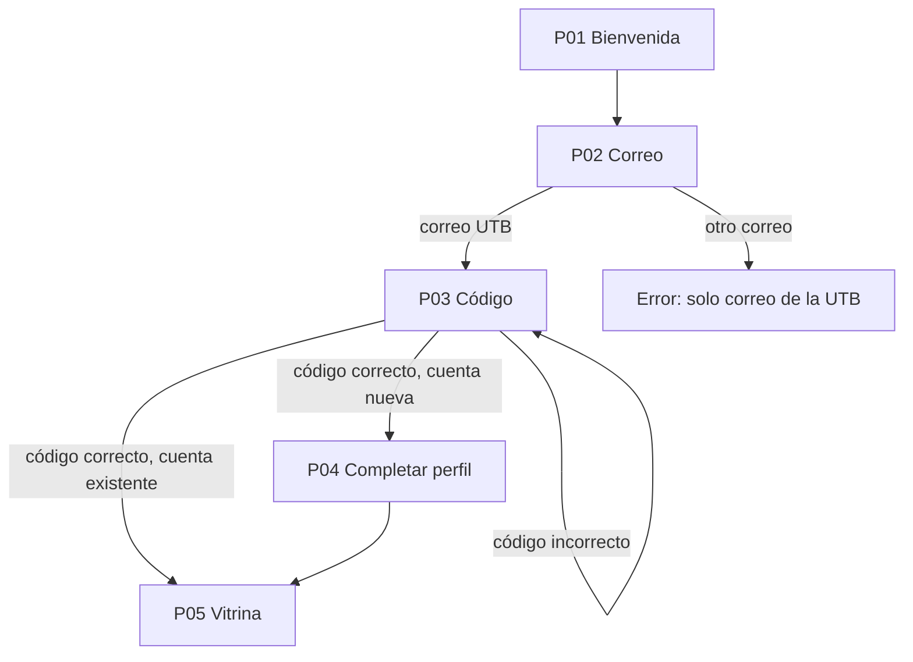
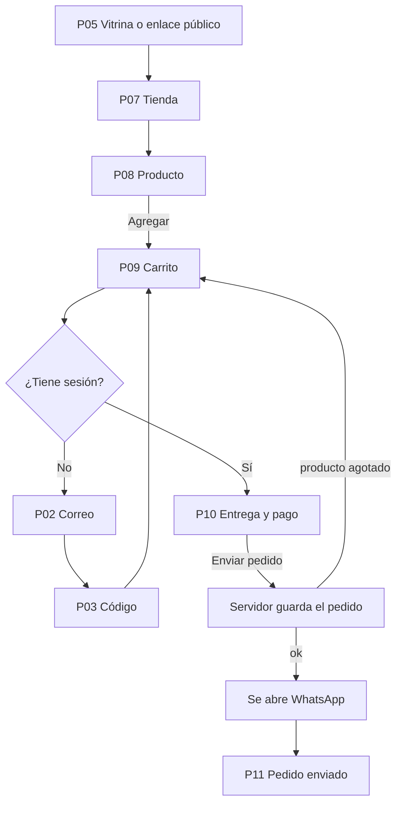
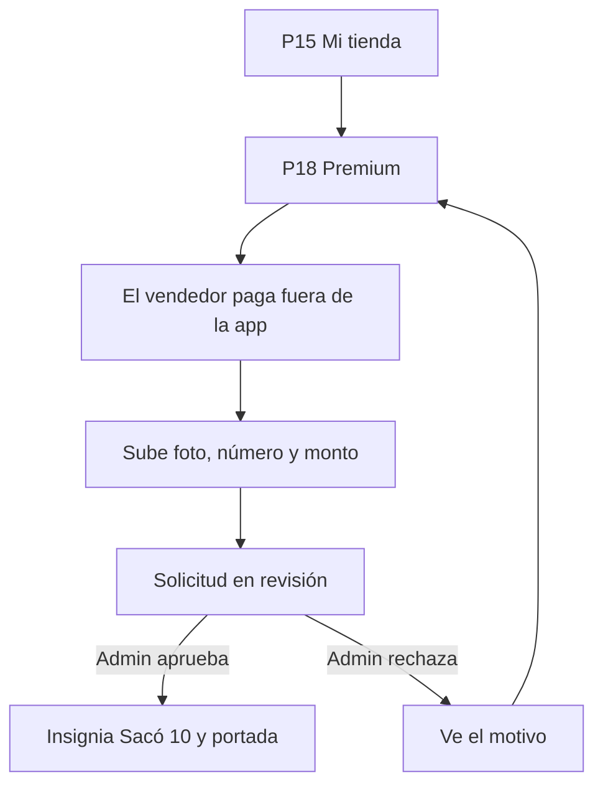
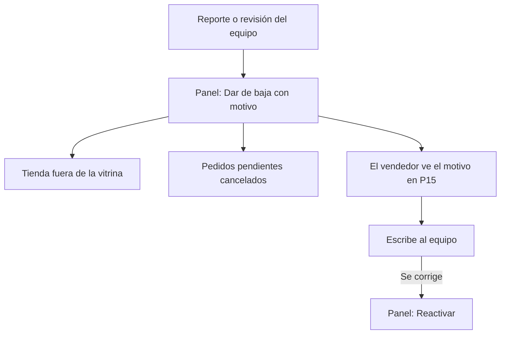

# Pantallas y recorridos del tramo 1

Versión 1, 12 de noviembre de 2026. Las pantallas son las mismas en la app de Android y en la versión web. El diseño visual (logo, colores, tipografía) se define en las semanas 3 y 4; mientras tanto, se programa con los componentes normales de Flutter (Material 3).

## 1. Navegación

Barra inferior con 4 secciones, siempre visible cuando hay sesión:

| Sección | Qué abre |
|---|---|
| Vitrina | P05 |
| Mis pedidos | P12 |
| Mi tienda | P15 si tiene tienda; si no, una invitación a crear una (P14) |
| Cuenta | P13 |

Sin sesión, solo se ven la vitrina, las tiendas y el botón "Entrar".

## 2. Lista de pantallas

| Código | Pantalla | Qué muestra | Historias |
|---|---|---|---|
| P01 | Bienvenida | Qué es PuntoKampus en una frase, botones "Entrar con mi correo UTB" y "Ver la vitrina" | H01 |
| P02 | Correo | Campo del correo, botón "Enviarme el código" | H01, H02 |
| P03 | Código | 6 casillas para el código, "Reenviar código" con cuenta regresiva de 60 segundos, "Cambiar correo" | H01, H02 |
| P04 | Completar perfil | Nombres, casilla "Acepto la política de privacidad" con enlace a P21, botón "Continuar" | H01 |
| P05 | Vitrina | Buscador arriba, categorías en fila deslizable, lista de tiendas (logo, nombre, insignia, categoría, punto de entrega) | H09 |
| P06 | Resultados de búsqueda | Pestañas "Productos" y "Tiendas" | H10 |
| P07 | Tienda | Portada (si es Premium), logo, nombre, insignia, descripción, horario, punto de entrega, WhatsApp (si lo muestra), productos, botón "Reportar" | H11, H12, H19 |
| P08 | Producto | Fotos, nombre, precio, descripción, "Agotado" si aplica, selector de cantidad, "Agregar al carrito" | H07, H13 |
| P09 | Carrito | Productos, cantidades, total, "Continuar" | H13 |
| P10 | Entrega y pago | Punto de entrega, día y hora, forma de pago, nota, total, "Enviar pedido" | H14 |
| P11 | Pedido enviado | Código del pedido, "Tu pedido quedó registrado", botón "Abrir WhatsApp" por si no se abrió solo, "Ver mis pedidos" | H14 |
| P12 | Mis pedidos | Lista con código, tienda, fecha, total y estado. Al tocar uno: detalle y "Cancelar pedido" si está pendiente | H15 |
| P13 | Cuenta | Mis datos, "Mostrar mi WhatsApp en mi tienda", "Política de privacidad", "Salir", "Borrar mi cuenta" | H03, H04, H06, H27 |
| P14 | Crear o editar tienda | Datos de vendedor (si faltan) y de la tienda, logo, portada (con candado si no es Premium) | H05, H06 |
| P15 | Mi tienda | Vista previa, botón "Compartir enlace", accesos a productos, pedidos y Premium. Si está dada de baja: el motivo y cómo escribir al equipo | H05, H22 |
| P16 | Producto nuevo o editar | Nombre, precio, descripción, hasta 3 fotos, interruptor "Disponible" | H07, H08 |
| P17 | Pedidos de mi tienda | Filtro por estado. Cada pedido con comprador, productos, punto, hora, pago y botones "Entregado" y "Cancelar" | H16, H17 |
| P18 | Premium | Plan actual, precio, beneficios, datos de la cuenta para pagar, formulario del comprobante, estado de la última solicitud | H20, H21 |
| P19 | Reportar tienda | Hoja que sube desde abajo: motivos, detalle, "Enviar reporte" | H19 |
| P20 | Tienda no disponible | "Esta tienda no está disponible" y "Ir a la vitrina" | H12 |
| P21 | Política de privacidad | El texto de la política | H27 |
| P22 | Borrar cuenta | Qué se borra, código de confirmación, "Borrar mi cuenta para siempre" | H04 |

## 3. Recorridos

### Entrar

### Hacer un pedido

### Pedir Premium

### Baja de una tienda

## 4. Estados que toda pantalla con datos debe tener

| Estado | Qué se ve |
|---|---|
| Cargando | Esqueletos grises con la forma del contenido, no una pantalla en blanco |
| Vacío | Qué es la sección, por qué está vacía y qué hacer (ver textos abajo) |
| Error de conexión | "No pudimos conectarnos. Revisa tu internet e inténtalo de nuevo" con botón "Reintentar" |
| Error del servidor | "Algo falló de nuestro lado. Inténtalo en unos minutos" |

## 5. Reglas de diseño

Estas reglas salen de las guías de accesibilidad y de uso en celulares. Se cumplen desde el primer día, no "al final":

| Regla | Detalle |
|---|---|
| Botones grandes | Todo lo que se toca mide al menos 48 × 48 dp, con 8 dp de separación |
| Texto legible | Texto normal de 16; nunca menos de 12. Contraste de al menos 4.5 a 1 entre el texto y el fondo |
| Etiquetas visibles | Cada campo tiene su etiqueta encima. El texto gris dentro del campo no reemplaza a la etiqueta |
| Errores junto al campo | El error aparece debajo del campo que falló, no solo arriba del formulario |
| Íconos con nombre | Ningún botón es solo un ícono sin texto o sin etiqueta para lectores de pantalla |
| Respuesta al tocar | Todo botón cambia al tocarlo. "Enviar pedido" se desactiva mientras espera al servidor, para que no se envíe dos veces |
| Listas largas | `ListView.builder` (carga solo lo visible) y paginación de 20 en 20 |
| Fotos | Se reducen antes de subirlas y se guardan en caché al mostrarlas, para gastar menos datos |
| Volver atrás | El botón "atrás" del celular y del navegador siempre lleva a la pantalla anterior |
| Enlace directo | `/t/{slug}` abre la tienda directamente, con o sin sesión |
| Teclado correcto | Correo con teclado de correo, precio y código con teclado numérico |

## 6. Textos de la interfaz

Tono: cercano y directo, de tú, como habla un estudiante con otro. Mismas palabras para lo mismo en toda la app: "tienda" (no "negocio" ni "local"), "pedido" (no "orden"), "vitrina" (no "catálogo").

### Botones

| Dónde | Texto |
|---|---|
| P01 | Entrar con mi correo UTB |
| P02 | Enviarme el código |
| P03 | Entrar |
| P04 | Continuar |
| P08 | Agregar al carrito |
| P10 | Enviar pedido |
| P11 | Abrir WhatsApp |
| P14 | Crear mi tienda / Guardar cambios |
| P15 | Compartir enlace |
| P17 | Entregado / Cancelar |
| P18 | Enviar comprobante |
| P19 | Enviar reporte |
| P22 | Borrar mi cuenta para siempre |

### Mensajes de error

| Situación | Texto |
|---|---|
| Correo que no es de la UTB | Solo se puede entrar con un correo de la UTB (termina en utb.edu.ec). |
| Código incorrecto | Ese código no es correcto. Te quedan {n} intentos. |
| Código vencido | Este código ya venció. Pide uno nuevo. |
| Demasiados intentos | Hiciste muchos intentos. Espera unos minutos y pide un código nuevo. |
| Producto agotado al enviar | {producto} se agotó mientras armabas tu pedido. Quítalo del carrito para continuar. |
| Hora de entrega muy pronto | Elige una hora desde las {hora mínima}. El vendedor necesita al menos 30 minutos. |
| Más de 3 fotos | Cada producto puede tener hasta 3 fotos. |
| Ya reportó hoy | Ya reportaste esta tienda hoy. Si pasa algo nuevo, puedes volver a hacerlo mañana. |

### Pantallas vacías

| Pantalla | Texto |
|---|---|
| Mis pedidos | Todavía no has hecho pedidos. Busca en la vitrina lo que necesitas. |
| Pedidos de mi tienda | Aún no te llegan pedidos. Comparte el enlace de tu tienda en tus grupos para que te encuentren. |
| Mis productos | Tu tienda no tiene productos. Agrega el primero para aparecer en la vitrina. |
| Búsqueda sin resultados | No encontramos nada con «{texto}». Prueba con otra palabra o revisa las categorías. |
| Categoría sin tiendas | Todavía no hay tiendas en {categoría}. ¿Vendes algo así? Crea tu tienda. |

### Confirmaciones

| Acción | Pregunta | Botones |
|---|---|---|
| Cancelar un pedido | ¿Cancelar el pedido {código}? El vendedor verá que lo cancelaste. | Cancelar pedido / Volver |
| Vaciar el carrito por cambiar de tienda | Tu carrito tiene productos de {tienda}. ¿Quieres vaciarlo y empezar uno nuevo? | Vaciar y continuar / Mantener carrito |
| Borrar un producto | ¿Borrar {producto}? Ya no aparecerá en tu tienda. | Borrar producto / Volver |
| Borrar la cuenta | Se borrarán tu cuenta, tu tienda, tus productos y tus fotos. No se puede deshacer. | Borrar mi cuenta para siempre / Volver |

### Avisos de éxito

| Situación | Texto |
|---|---|
| Pedido guardado | Tu pedido {código} quedó registrado. Termina de enviarlo por WhatsApp. |
| Tienda creada | ¡Tu tienda ya está en la vitrina! |
| Comprobante enviado | Recibimos tu comprobante. Verás el resultado en esta misma pantalla cuando lo revisemos. |
| Reporte enviado | Gracias. El equipo lo revisará en 24 horas. |
